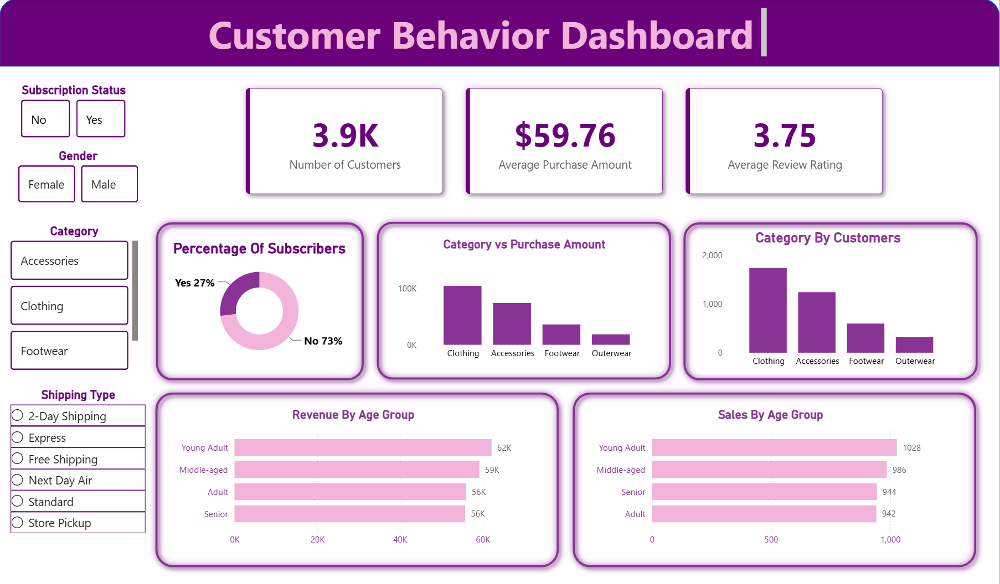
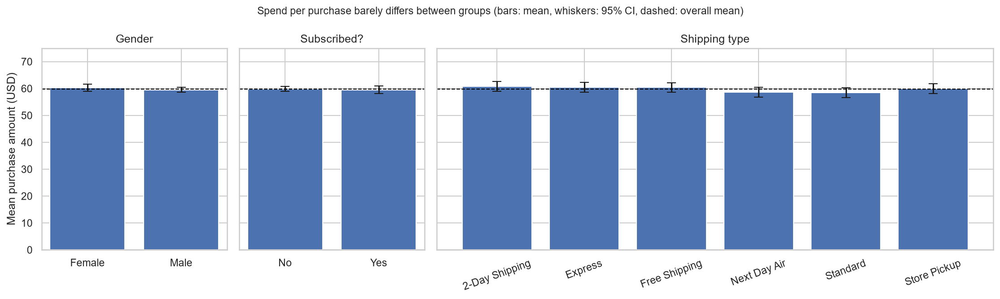
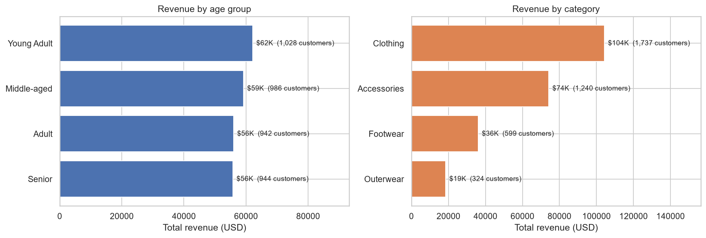
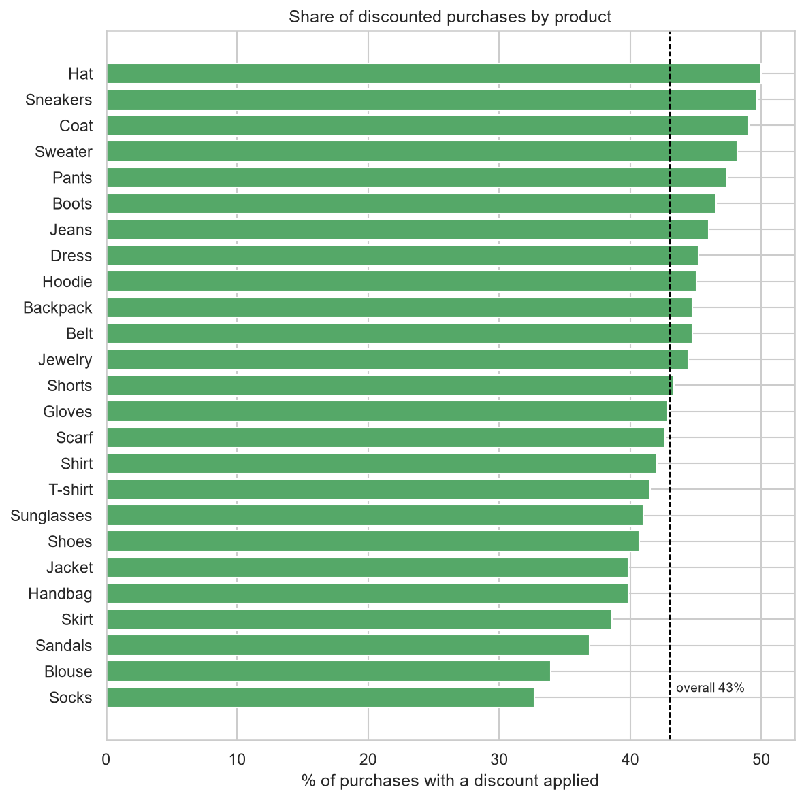
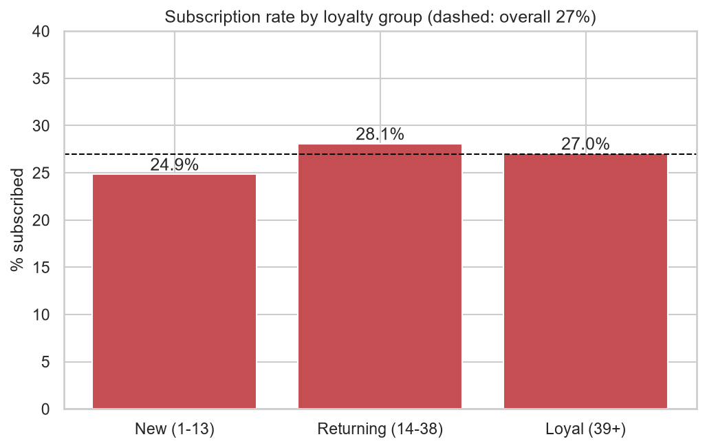

# Customer Shopping Behaviour: testing whether any customer group really spends more (synthetic data)


**No group spends meaningfully more per purchase; revenue gaps come from how many customers each group has.**

| | |
|---|---|
| **Problem** | A retailer deciding where to spend a marketing budget tends to chase "valuable" groups (subscribers, one gender, loyal buyers) without checking that they spend more. |
| **Solution** | Cleaned 3,900 purchases in Python, answered ten business questions in MySQL, tested each gap statistically and built a Power BI dashboard. |
| **Result** | **Group averages sit within about $3 of each other; no spend gap is significant.** Several claims in the first report did not survive testing and are corrected below. |
| **My role** | Solo project. |



*Screenshot of `powerbi/dashboard.pbix` taken from the original project report. Its headline numbers match the notebook: 3.9K customers, $59.76 average purchase, 3.75 average rating, 27% subscribers.*

> **The dataset is synthetic.** Its Kaggle author states it was generated with ChatGPT. The project shows an analysis workflow; it says nothing about real shoppers.

## Problem statement

A retailer wants to know where to put a marketing and retention budget. The usual instinct is to chase the groups that look most valuable: subscribers, one gender, express-shipping customers, loyal buyers. That only makes sense if those groups really spend more per purchase.

This project asks:

1. Which customer groups differ in how much they spend, and are the differences big enough to act on?
2. Which products depend most on discounts, and do discounts go with larger purchases?
3. Are loyal customers and repeat buyers more likely to subscribe?

The data answers the first question mostly with "no", which changes what a sensible recommendation looks like (see [Key insights](#key-insights-and-recommendations)).

## Data

| Property | Detail |
|---|---|
| Rows / columns | 3,900 rows (one per customer purchase) x 18 columns; `Customer ID` is unique, no duplicate rows |
| Source | [Customer Shopping Trends Dataset](https://www.kaggle.com/datasets/iamsouravbanerjee/customer-shopping-trends-dataset) by Sourav Banerjee, Kaggle (the first rows on that page match the raw file here) |
| Nature and licence | Synthetic: the author says it was generated with ChatGPT. Kaggle lists the licence as "Other (specified in description)" |
| Raw file | `data/raw/customer_shopping_behavior.csv` |
| Cleaned file | `data/cleaned/customers.csv` (19 columns), reproduced exactly by the notebook |
| Missing values | 37 in `Review Rating` (0.9%), filled with the median rating of the product's category |
| Redundant column | `Promo Code Used` is identical to `Discount Applied` on every row (checked in the notebook) and was dropped |

**Feature groups:** demographics (age, gender, location, subscription status), purchase details (item, category, purchase amount, season, size, colour), and shopping behaviour (discount applied, previous purchases, purchase frequency, review rating, shipping type).

**What the synthetic origin looks like in the data.** Seven purchase-frequency categories each hold about 550 rows, and average spend barely moves across any grouping. The findings show how to analyse data like this, not how real shoppers behave.

## Methodology

1. **Clean in Python** (`notebooks/customer_trend_data_analysis.ipynb`): impute ratings by category median, standardise column names, build `age_group` (quartiles of age: 18-31, 32-44, 45-57, 58-70) and `purchase_frequency_days`, drop the redundant column.
2. **Load into MySQL** (`sql/01_schema.sql`, `sql/02_load.sql`): a typed table with CHECK constraints and a load script.
3. **Answer ten business questions in SQL** (`sql/03_analysis.sql`). Expected output is in [`sql/expected_results.md`](sql/expected_results.md).
4. **Test, do not eyeball.** The notebook reproduces the SQL answers in pandas as a cross-check, then tests each group comparison: Welch's t-test with a 95% confidence interval and Cohen's d for two groups, one-way ANOVA for more, and chi-square for proportions.
5. **Dashboard in Power BI** (`powerbi/dashboard.pbix`) for interactive exploration.

## Results

### Spend per purchase by group



| Comparison | Result | Test |
|---|---|---|
| Male vs female | $59.54 vs $60.25 (diff -$0.71, 95% CI -$2.30 to +$0.87) | Welch p = 0.38 |
| Subscribers vs non-subscribers | $59.49 vs $59.87 (diff -$0.37, 95% CI -$2.04 to +$1.29) | Welch p = 0.66 |
| Six shipping types | $58.46 to $60.73 | ANOVA p = 0.35 |
| Four age groups | $59.07 to $60.45 | ANOVA p = 0.57 |
| Four categories | $57.17 to $60.26 | ANOVA p = 0.23 |
| Three loyalty groups | $59.47 to $60.14 | ANOVA p = 0.73 |

### Revenue follows customer counts



Men are 68% of customers and bring 67.7% of revenue; women are 32% and bring 32.3%. The age group with the most revenue (18-31, $62,143) is also the largest, with 1,028 customers.

### Discounts



- 43.0% of purchases (1,677) used a discount, and 839 of those discount users (50.0%) spent more than the $59.76 average. The share among customers without a discount is almost the same, 50.6%.
- Average spend is $59.28 with a discount and $60.13 without (p = 0.27).
- The five products with the highest discount share are Hat (50.0%), Sneakers (49.7%), Coat (49.1%), Sweater (48.2%) and Pants (47.4%). The differences between products are not significant (chi-square p = 0.13), so treat this ranking as a weak signal.

### Loyalty and subscription



- Customers with more than 5 previous purchases subscribe at 27.6% (n = 3,476) against 22.4% for the rest (n = 424). That is +5.2 percentage points (95% CI +0.9 to +9.4, chi-square p = 0.03): small, and it rests on one cut-off, since the continuous correlation is weak (r = 0.03, p = 0.054).
- Using quartile cut-offs, 26.0% of customers are New (1-13 previous purchases), 50.2% Returning (14-38) and 23.8% Loyal (39+). Spend does not differ between them (p = 0.73).

## Key insights and recommendations

The recommendations show what an analyst would advise **if this simulated data were real**. They are limited to what the data supports.

1. **Do not target on expected spend.** No group spends meaningfully more per purchase, so there is no high-value segment to favour on basket size. Differences in revenue are differences in customer counts.
2. **Gender: this is an acquisition question, not a spend question.** Female customers are 32% of the base and spend the same per purchase as male customers. If growth is the goal, the lever is reaching more women, which needs a campaign test, not an assumption.
3. **Test discounts before cutting or expanding them.** Discount users do not buy more per purchase ($59.28 vs $60.13). This data cannot show whether discounts drive the purchase itself, so run a holdout test (some customers get no offer) to measure it.
4. **Subscription pushes should start with repeat buyers.** They subscribe at a slightly higher rate (27.6% vs 22.4%). Subscribers do not spend more per purchase, so judge the programme on retention and lifetime value, which this dataset does not contain.
5. **Do not justify shipping fees or loyalty tiers from this data.** Spend is flat across shipping types and loyalty groups, so any premium-shipping or tier design needs its own test.
6. **Collect better data next.** Purchase dates, cost and margin, returns and repeat orders per customer would allow real retention and profitability analysis.

### Corrections to the original report and presentation

The [Word report and slide deck](archive/) were written before the checks above. They are kept unchanged in `archive/`, but a few statements in them do not match the data:

| Original statement | What the data shows |
|---|---|
| "Top 5 products with highest percentage of discounted purchases". The report's result screenshot shows Socks, Blouse, Sandals, Skirt, Handbag (33-40%), because the query sorted ascending | Those are the *lowest* five. The highest are Hat, Sneakers, Coat, Sweater, Pants (47-50%). The query is fixed in `sql/03_analysis.sql` |
| "Subscribers show different spending behavior than non-subscribers" | $59.49 vs $59.87, not significant (p = 0.66) |
| Revenue differs "notably" between men and women, so target by gender | It is a customer-count gap (68% / 32%); spend per purchase is the same |
| Customers are "New / Returning / Loyal" (1 / 2-10 / 11+ purchases) | That puts 79.9% of customers in "Loyal". Quartile cut-offs are used instead |
| Customers with more than 5 purchases "show higher subscription likelihood" | Weakly true: +5.2 points, p = 0.03, small and cut-off dependent |

## Limitations and future improvements

- **Synthetic data.** No conclusion transfers to a real retailer.
- **One row per customer.** There is no time dimension, so retention, seasonality and repeat purchase cannot be studied.
- **Revenue is the purchase amount only.** There is no cost, margin or return data.
- **Statistical significance is not business value.** A small but real effect (such as the repeat-buyer subscription gap) can still be worth acting on if the intervention is cheap.
- **Multiple comparisons.** Many tests were run; one p-value near 0.03 should be treated with care.
- **Future:** a cost-aware uplift test design for discounts and subscriptions, and a proper time-based retention analysis if dated data becomes available.

## Installation and how to run

Tested with **Python 3.15** and **MySQL 8.0.46** on Windows 11. A fresh install takes about 3.5 minutes and the notebook runs in about 40 seconds (verified from a clean clone).

### 1. Python notebook

```bash
git clone https://github.com/abdullahwaheed0112/customer-behaviour-analysis.git
cd customer-behaviour-analysis
python -m venv .venv
# Windows: .venv\Scripts\activate      macOS/Linux: source .venv/bin/activate
pip install -r requirements.txt
pip install jupyterlab
cd notebooks
jupyter lab customer_trend_data_analysis.ipynb
```

Run the notebook from inside `notebooks/` (paths are relative). It checks that it reproduces `data/cleaned/customers.csv` and writes the figures to `docs/images/`. Saved outputs are already in the notebook.

### 2. MySQL (run from the repository root)

```bash
mysql -u root -p < sql/01_schema.sql
mysql --local-infile=1 -u root -p < sql/02_load.sql
mysql -u root -p customer_behavior < sql/03_analysis.sql
```

`LOAD DATA LOCAL INFILE` must be allowed on the server (`SET GLOBAL local_infile = 1;`, administrator account). Compare the output with [`sql/expected_results.md`](sql/expected_results.md).

### 3. Power BI

Open `powerbi/dashboard.pbix` in Power BI Desktop.

## Project structure

```text
customer-behaviour-analysis/
├── data/
│   ├── raw/customer_shopping_behavior.csv
│   └── cleaned/customers.csv
├── docs/images/                       # figures used in this README
├── notebooks/
│   └── customer_trend_data_analysis.ipynb
├── powerbi/
│   └── dashboard.pbix
├── archive/                           # original report and slides, unchanged
│   ├── README.md
│   ├── customer_behavior_report.docx
│   └── Customer-Shopping-Behavior-Analysis.pptx
├── sql/
│   ├── 01_schema.sql
│   ├── 02_load.sql
│   ├── 03_analysis.sql
│   └── expected_results.md
├── requirements.txt
├── README.md
└── LICENSE
```

## Tech stack

Python (pandas, NumPy, SciPy, matplotlib, seaborn) · MySQL 8.0 (window functions, CTEs) · Power BI · Jupyter

## My role, license and contact

- **Author:** Abdullah Waheed, BS Data Science student at FAST NUCES, Islamabad.
- **Code licence:** [MIT](LICENSE), for the code in this repository.
- **Data licence:** the dataset belongs to its author and is not covered by the MIT licence (see Data).
- **Contact:** [GitHub](https://github.com/abdullahwaheed0112) · [LinkedIn](https://linkedin.com/in/abdullah-waheed-05a5a1416)
